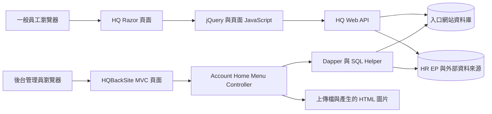
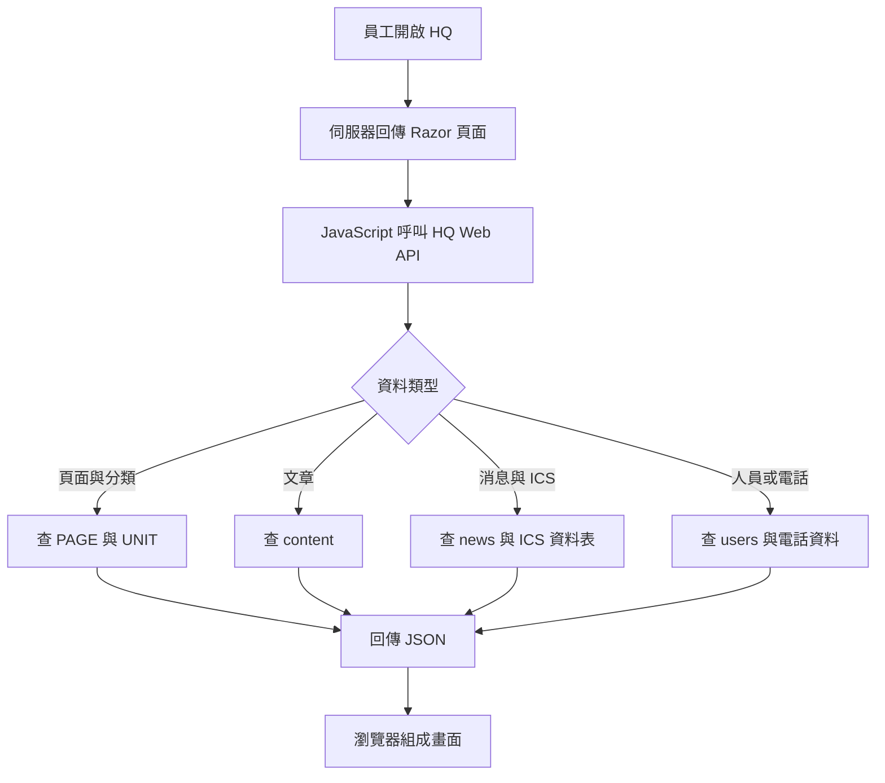
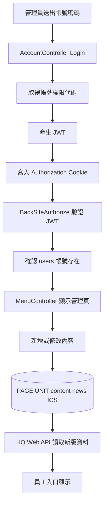
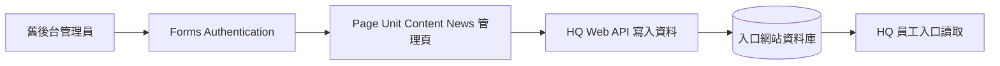
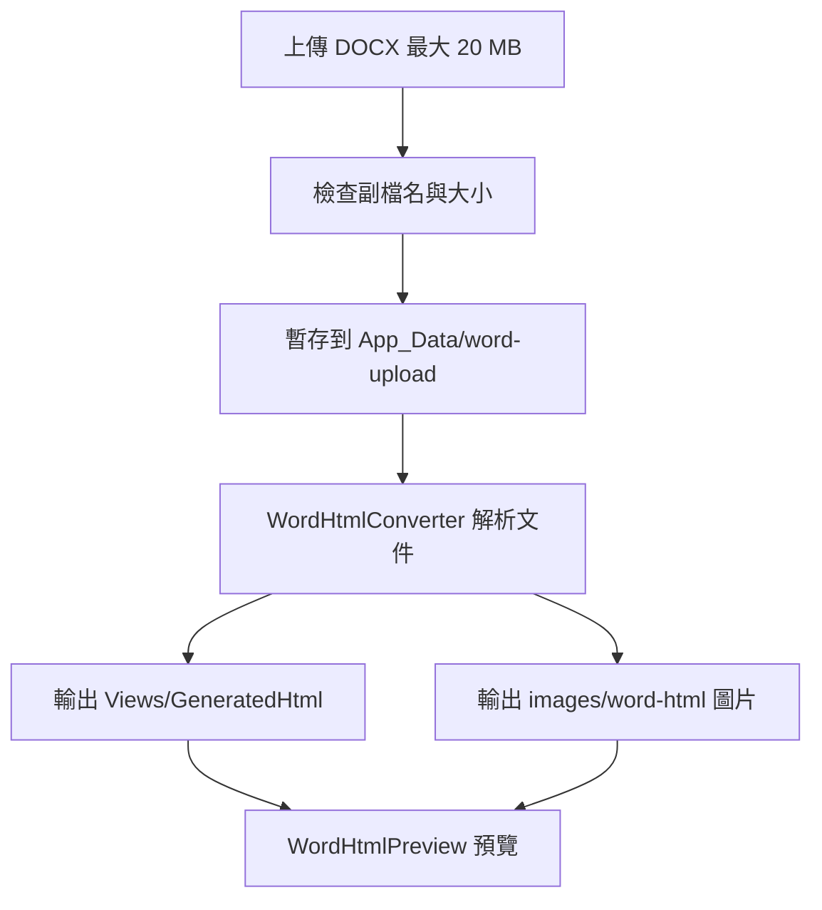
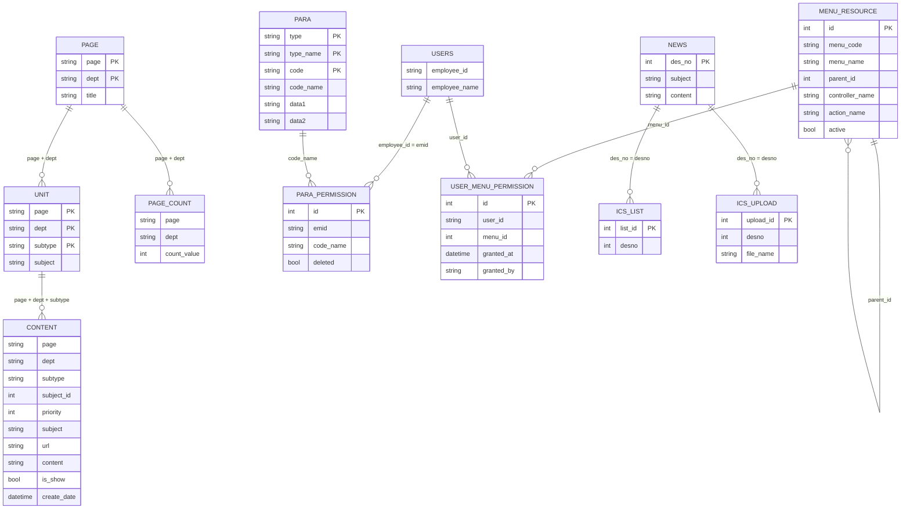

# HQ / HQBackSite 專案說明書

> 盤點日期：2026-10-27
> 程式版本：`features/word-to-html`，`875f4130f09799e2d63ccc0b24a2efacbeaeebcd`
> 本文件說明目前程式行為。資料表關聯取自程式查詢，未確認為資料庫外鍵。

## 1. 系統用途

這套系統是新光三越內部入口網站，由兩個網站組成：

| 系統 | 專案資料夾 | 使用者 | 主要用途 | 本機網址 |
|---|---|---|---|---|
| HQ | `HQ/` | 一般員工、舊後台管理員 | 閱讀公告、部門內容、ICS 資訊，也保留舊版內容管理功能 | `http://localhost:14555/` |
| HQBackSite | `HQBackSite/` | 新版後台管理員 | 維護分類、文章、公告、ICS、權限與 Word 轉 HTML | `http://localhost:57568/` |

兩者不是「前端 SPA + 後端 API」的拆法。它們都是 ASP.NET MVC 網站，也都會直接存取資料庫。

## 2. 整體架構



### 技術基礎

| 項目 | HQ | HQBackSite |
|---|---|---|
| Framework | .NET Framework 4.6.1 | .NET Framework 4.7.2 |
| Web 架構 | ASP.NET MVC 5 + Web API 2 | ASP.NET MVC 5 |
| 畫面 | Razor、HTML、jQuery | Razor、jQuery、Bootstrap 類元件 |
| 資料存取 | ADO.NET、`SqlCommand`、`DataSet` | Dapper、共用 SQL Helper |
| 驗證 | 舊後台使用 Forms Authentication | JWT 存於 `Authorization` Cookie |
| 測試 | 無獨立測試專案 | MSTest，位於 `tests/HQBackSite.Tests/` |

## 3. 專案目錄

| 路徑 | 說明 |
|---|---|
| `HQ/Controllers/` | 員工入口與舊後台 MVC Controller |
| `HQ/Controllers/Api/` | 員工入口使用的 Web API |
| `HQ/Views/` | 員工入口與舊後台 Razor 畫面 |
| `HQ/js/`、`HQ/css/` | 前台頁面的 JavaScript 與樣式 |
| `HQBackSite/Controllers/` | 新版後台登入、首頁與內容管理 |
| `HQBackSite/Views/` | 新版後台 Razor 畫面 |
| `HQBackSite/Models/` | 資料模型與畫面模型 |
| `HQBackSite/Attributes/` | 權限、操作紀錄與例外處理 |
| `HQBackSite/Utils/` | Word 轉 HTML 等工具 |
| `tests/HQBackSite.Tests/` | 新版後台的 MSTest 測試 |
| `memory-bank/` | 接手文件、程式索引與 RAG 資料 |

## 4. 主要功能

### 4.1 HQ 員工入口

- 首頁：跑馬燈、橫幅、公告、HR／IT／職安資訊與常用連結。
- 部門頁：依 `PAGE`、`UNIT` 與 `content` 組成頁籤和文章。
- 最新消息：讀取 `news`，部分消息連動 ICS 資料。
- 電話查詢：查詢門市、員工與單位電話。
- 舊系統整合：部分內容仍讀取既有 WebMax 或外部資料來源。
- 瀏覽統計：依頁面與部門累計使用次數。

### 4.2 HQ 舊後台

- 維護頁面、單元、文章與消息。
- 維護職安、HR 等既有專區。
- 使用 Forms Authentication 登入。
- 主要畫面位於 `HQ/Views/Backside/`。

此區仍與正式資料共用相同資料表。停用前需確認所有管理功能已搬到新版後台。

### 4.3 HQBackSite 新版後台

| 模組 | 用途 | 主要資料 |
|---|---|---|
| Index | 後台首頁與可用選單 | `t_menu_resource`、`t_user_menu_permission` |
| Permission | 人員與功能權限 | `para`、`para_permission` |
| Category | 頁面與分類設定 | `PAGE`、`UNIT` |
| Content | 文章內容管理 | `content` |
| Message | 一般、燈號等消息管理 | `news` |
| ICS | ICS 名單與附件管理 | `ics_list`、`ics_upload`、`news` |
| WordHtml | 將 `.docx` 轉成可預覽 HTML | 檔案系統 |
| Menu permission | 控制後台選單顯示 | `t_menu_resource`、`t_user_menu_permission` |

## 5. 使用流程

### 5.1 員工閱讀內容



### 5.2 新版後台登入與發布



注意：目前登入程式中的 AD 驗證已被註解，權限代碼也有硬編碼回傳。這不是完整的正式身分驗證，部署前必須修正，詳見第 11 節。

### 5.3 舊後台發布



### 5.4 Word 轉 HTML



正式 IIS 帳號需有上述輸出目錄的必要寫入權限。不要授予整個網站根目錄寫入權限。

## 6. 路由與 API

兩個網站的 MVC 路由皆為 `{controller}/{action}/{id}`。HQ 預設為 `Hq/Index`，HQBackSite 預設為 `Home/Index`。

HQ Web API 路由為 `api/{controller}/{action}/{id}`：

| API Controller | 責任 |
|---|---|
| `MainController` | 首頁資料、跑馬燈、共用查詢與工具功能 |
| `DeptController` | 部門與單位資料 |
| `PageController` | 頁面設定 |
| `UnitController` | 分類與頁籤 |
| `ContentController` | 文章內容 |
| `NewsController` | 最新消息 |
| `IcsController` | ICS 名單與附件 |
| `RoomController` | 會議室或空間資料 |
| `MarqueeController` | 跑馬燈 |
| `ValuesController` | 舊版共用查詢功能 |

API 名稱與參數由既有頁面直接使用。變更前應先搜尋 JavaScript、Razor 與其他 Controller 的呼叫端。

## 7. 資料模型

### 7.1 核心 ER Model

以下是程式查詢所呈現的邏輯關聯，不代表資料庫已建立 Foreign Key。



### 7.2 資料表分組

| 分組 | 資料表 | 說明 |
|---|---|---|
| 網站結構 | `PAGE`、`UNIT` | 決定頁面、部門與分類 |
| 文章內容 | `content` | 儲存文章、排序、連結與顯示狀態 |
| 消息 | `news` | 儲存一般消息、燈號與 ICS 主資料 |
| ICS | `ics_list`、`ics_upload` | 儲存名單與附件 |
| 參數權限 | `para`、`para_permission` | 儲存功能代碼及人員授權 |
| 後台選單 | `t_menu_resource`、`t_user_menu_permission` | 儲存選單與使用者可見權限 |
| 人員電話 | `users`、`StoreTel`、`emp_tel` | 儲存員工、門市與電話資料 |
| 統計 | `[count]` | 儲存頁面瀏覽次數 |

### 7.3 外部資料來源

程式還會讀取 HR、EP、活動內容與既有 WebMax 資料。設定檔中使用的連線名稱包括：

- `SqlServer`
- `TestSqlServer`
- `EpSqlServer`
- `NewsLetter`

正式連線值屬環境機密，不應寫入說明書或版本庫。

## 8. 驗證、授權與紀錄

### HQ 舊後台

- 使用 Forms Authentication。
- 登入狀態與新版後台 JWT 不共用。
- 部分 Web API 寫入方法未看到明確的授權屬性，不能視為已受保護。

### HQBackSite 新版後台

- 登入後把 JWT 寫入 `Authorization` Cookie。
- `BackSiteAuthorize` 驗證 Token，再查 `users` 確認帳號。
- 一般請求未登入時導回登入頁。
- Ajax 未登入時回傳 `code = -1` 與「請先登入」。
- 本機可用 `LocalBootstrapAccounts` 開發設定，但正式環境應停用。

### 選單權限

- `t_menu_resource` 定義選單。
- `t_user_menu_permission` 定義使用者可看到的項目。
- 目前主要作用是前端隱藏選單，Controller 尚未逐功能強制檢查。已登入者可能直接輸入網址進入未顯示的功能。

### 操作紀錄

- `OperationLogAttribute` 記錄後台操作。
- `GlobalExceptionFilterAttribute` 統一處理未捕捉例外。
- 紀錄程式有遮罩處理，但仍不可把密碼、Token 或完整設定檔寫入 Log。

## 9. 建置、啟動與部署

### 開發環境

1. 安裝 Visual Studio 2022 與 ASP.NET/.NET Framework 開發元件。
2. 還原 NuGet 套件。
3. 開啟 `HQ.sln` 並建置方案。
4. 分別啟動 HQ 與 HQBackSite。
5. 確認 `14555` 與 `57568` 網址可開啟。

本機 Port 來自 `.vs/HQ/config/applicationhost.config`，其他電腦可能不同。

### 客戶端部署

1. 將 HQ 與 HQBackSite 分別發布成兩個 IIS Application。
2. 依環境設定四組 Connection String，不沿用開發機密碼。
3. 設定 `TestingMode`、`EnableLocalLoginDebug` 與 `LocalBootstrapAccounts`。
4. 正式環境關閉本機登入除錯功能。
5. 只對上傳與產生檔案目錄授予寫入權限。
6. 逐一測試首頁、登入、文章、消息、ICS 與 Word 預覽。
7. 驗證 Log 目錄可寫，且沒有敏感資訊。

## 10. 測試方式

新版後台測試專案為 .NET Framework 4.7.2 MSTest：

```powershell
$msbuild = 'C:\Program Files\Microsoft Visual Studio\2022\Community\MSBuild\Current\Bin\MSBuild.exe'
$vstest = 'C:\Program Files\Microsoft Visual Studio\2022\Community\Common7\IDE\CommonExtensions\Microsoft\TestWindow\vstest.console.exe'

& $msbuild 'tests\HQBackSite.Tests\HQBackSite.Tests.csproj' /t:Build /p:Configuration=Debug /v:minimal
& $vstest 'tests\HQBackSite.Tests\bin\Debug\net472\HQBackSite.Tests.dll'
```

現有測試主要涵蓋 Word 轉 HTML、Content 與 ICS。HQ Web API 尚缺直接的自動化測試。根目錄 `package.json` 沒有可用的 `npm test`，不能用它代表系統已測試。

## 11. 部署前風險

依處理優先度排列：

1. **登入驗證不完整**：`AccountController.Login` 的 AD 驗證已註解，`GetUserCodeNames(string emid)` 目前回傳硬編碼權限。若帳號存在於 `users`，非空密碼可能取得 JWT。正式部署前必須修復並做登入測試。
2. **授權只做到選單顯示**：選單權限未完整下沉到 Controller Action。需補伺服器端功能授權。
3. **舊 API 保護不足**：HQ 多個寫入 API 未看到一致的授權檢查。需列出寫入端點並封鎖未登入呼叫。
4. **動態 SQL 風險**：`ValuesController.SqlString` 等舊程式會組合 SQL。需逐項確認參數化與可呼叫範圍。
5. **跨表寫入一致性**：消息與 ICS 子資料以多次 SQL 寫入，未看到完整交易包覆。中途失敗可能留下半套資料。
6. **文件與程式不同步**：根目錄 `MENU_PERMISSION_TECH_DOC.md` 使用舊表名 `portal_menu_resources`、`portal_menu_permissions`；目前程式使用 `t_menu_resource`、`t_user_menu_permission`。
7. **例外資訊外洩**：部分舊 API 會直接回傳例外文字。正式環境應回傳通用訊息，詳細內容只留在受控 Log。

## 12. 維護入口

| 要修改的內容 | 先看位置 |
|---|---|
| HQ 首頁與部門頁 | `HQ/Controllers/HqController.cs`、`HQ/Views/Hq/`、`HQ/js/` |
| HQ API | `HQ/Controllers/Api/` |
| 舊後台 | `HQ/Controllers/BacksideController.cs`、`HQ/Views/Backside/` |
| 新後台登入 | `HQBackSite/Controllers/AccountController.cs`、`HQBackSite/Attributes/BackSiteAuthorizeAttribute.cs` |
| 新後台內容管理 | `HQBackSite/Controllers/MenuController.cs`、`HQBackSite/Views/Menu/` |
| SQL 共用方法 | `HQBackSite/Controllers/BaseController.cs` |
| Word 轉 HTML | `HQBackSite/Utils/WordHtmlConverter.cs`、`HQBackSite/Controllers/MenuController.cs` |
| 測試 | `tests/HQBackSite.Tests/` |
| 詳細檔案索引 | `memory-bank/10-modules/hq-file-analysis.md` |
| RAG 入口 | `memory-bank/30-rag/rag-index.md` |
